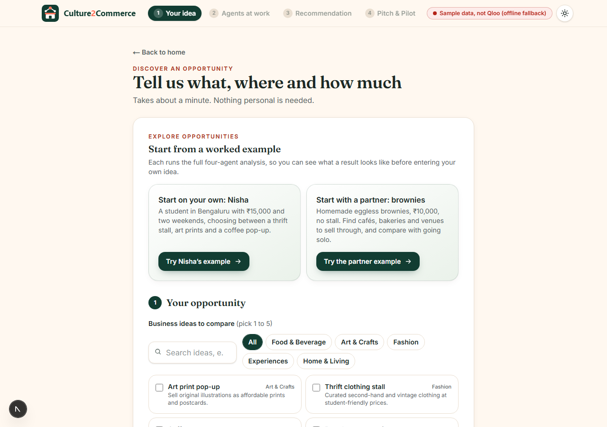
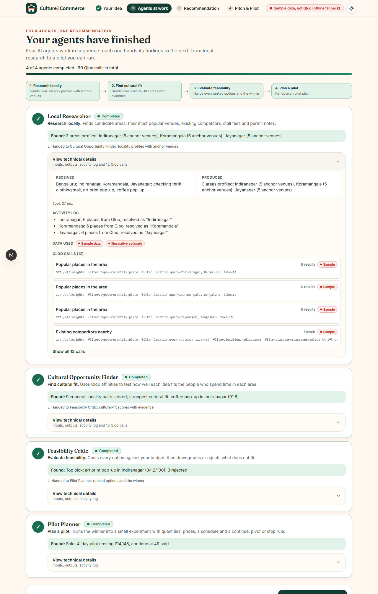
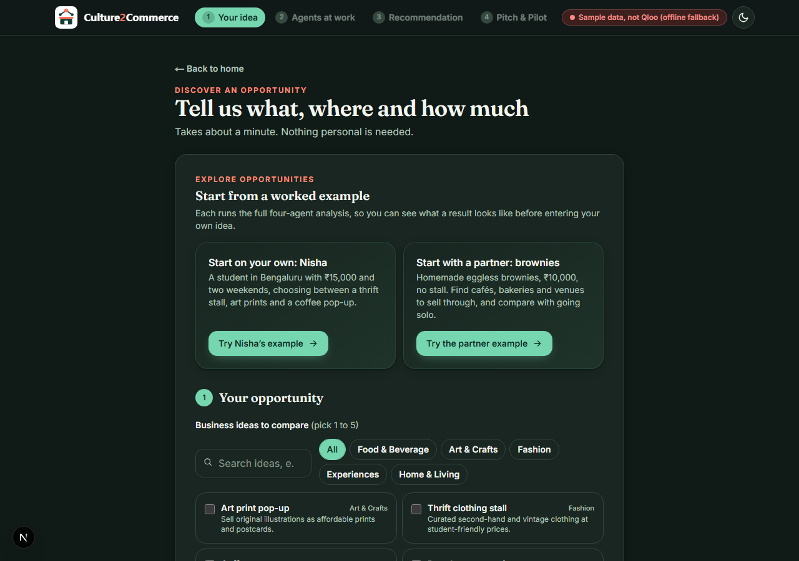
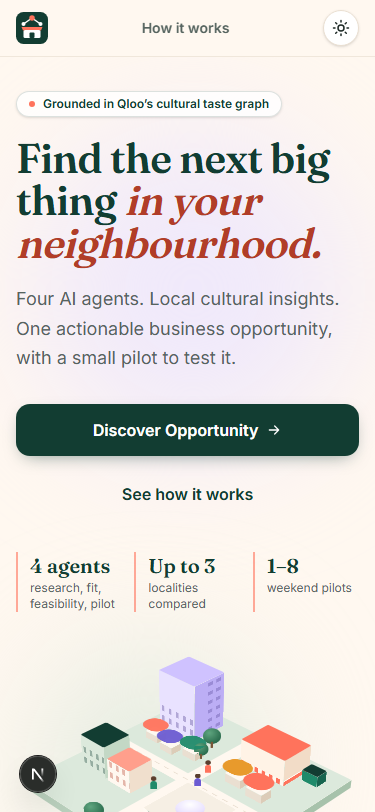
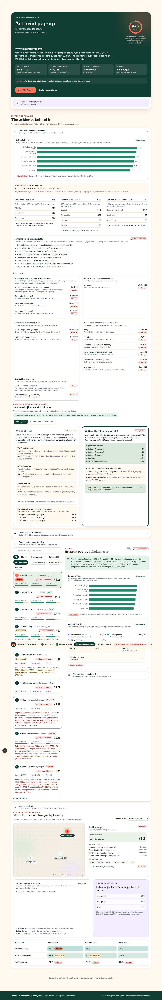
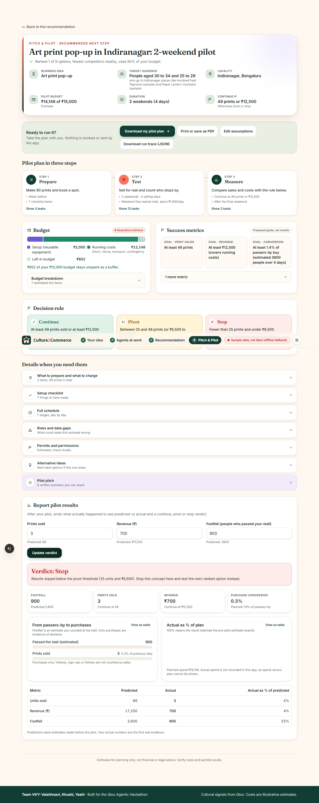
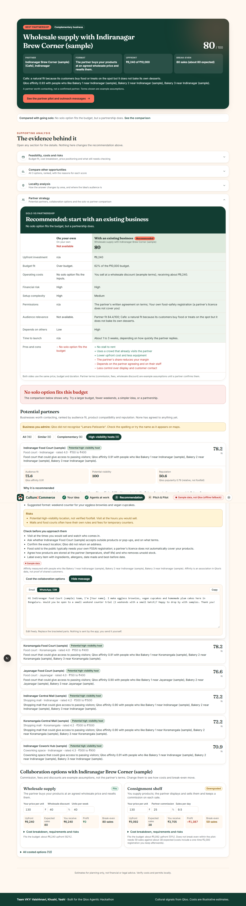
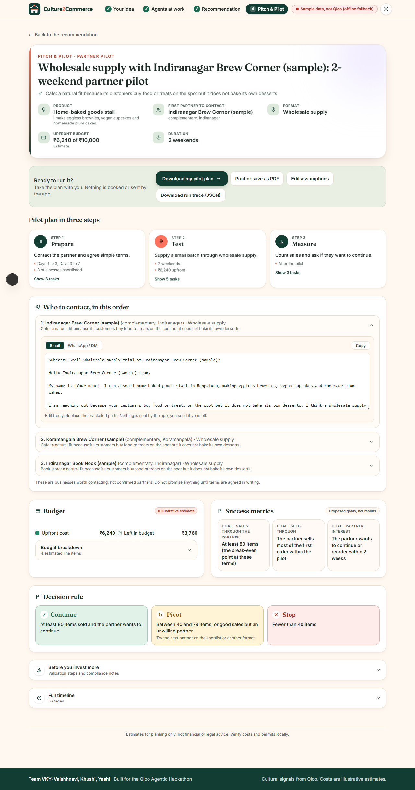
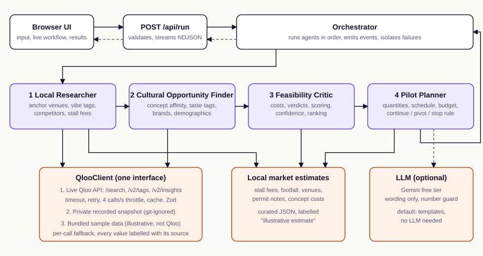

<p align="center">
  
</p>

<h1 align="center">Culture2Commerce</h1>

<p align="center"><strong>Find one small business bet worth testing.</strong><br>
A micro-business opportunity discovery agent grounded in Qloo's taste graph.</p>

<p align="center">Built by <strong>Team VKY</strong> (Vaishhnavi, Khushi, Yashi) for the Qloo Agentic Hackathon.</p>

---

## The problem

A student or first-time entrepreneur with ₹10,000 to ₹20,000 wants to try a weekend stall,
a pop-up or a paid workshop before committing to a shop. Ask a generic AI which idea to try
and it lists pros and cons for every option and concludes "it depends".

## The solution

Culture2Commerce uses cultural and local evidence to recommend **one specific bet**:

> **specific concept + suitable locality + target audience + pilot experiment**

It does three things together:

1. **Cultural fit.** Qloo taste relationships show which concepts resonate with the people who
   already spend time in each locality.
2. **Feasibility.** Budget, competition, logistics and venues are checked. Options that do not
   fit are downgraded or rejected, with the reason shown.
3. **Validation.** The winner becomes a low-cost real-world pilot with a measurable
   continue / pivot / stop rule, and a form to compare predicted and actual results.

### Start on your own, with an existing business, or compare both

Many people have a product but cannot afford a stall. The first question in the app is
**"How do you want to start?"**

- **On my own:** a stall, pop-up or workshop, as above.
- **With an existing business:** Culture2Commerce finds businesses worth approaching and
  plans a partnership pilot:
  - **similar businesses** (for brownies: bakeries and dessert shops), flagged as possible competitors;
  - **complementary businesses** (cafés, juice bars, bookshops) whose crowd may want the product;
  - **potential high-visibility hosts** (food courts, malls, co-working spaces), labelled as
    *potential* visibility because no visitor counts exist.

  It then costs four collaboration formats (consignment shelf, weekend counter, co-hosted
  workshop, wholesale supply), lets you change the assumptions, recommends one, and writes an
  email and a WhatsApp message to send yourself.
- **Show me both:** a like-for-like comparison of the two approaches, with a recommendation
  that follows the numbers (solo wins when it is cheaper and stronger; partnering wins when no
  stall fits the budget).

Two optional fields sharpen the search: **"Describe your product"** (matched to Qloo tags such
as *Brownie* or *Egg free*) and **"A business you admire"** (Qloo finds places with a similar crowd).

### Built-in examples

Nisha is a student in Bengaluru with ₹15,000 and two weekends. She is choosing between a
thrift stall, art prints and a coffee pop-up, and prefers something creative and low-risk.
Click **Try Nisha's example** to watch the four agents work through it.

**The partner example:** homemade eggless brownies, ₹10,000, no stall. Click
**Try the partner example** to see the solo-versus-partner comparison, partners found through
Qloo (including places with a crowd like Lamara Patisserie, the "business you admire"), and
ready-to-send outreach drafts.

## Screenshots

These were captured by the end-to-end test in offline mode, so every venue is bundled sample
data marked "(sample)". With a Qloo key the same screens show real Qloo places and affinities.

The app is a short journey: **landing page → Your idea (`/discover`) → Agents at work
(`/agents`) → Recommendation (`/recommendation`) → Pitch & Pilot (`/plan`)**. The step bar in
the header lets you move back and forth; the finished run and your form inputs survive a refresh
or the browser back button (kept in this browser tab only). A sun/moon button in the header
switches between light and dark mode; it follows your system setting until you choose.

| Landing | Your idea |
|---|---|
|  |  |

| Agents at work | Dark mode and phone width |
|---|---|
|  |   |

| Recommendation, scores and evidence | Pilot plan and results |
|---|---|
|  |  |

| Solo vs partnership and potential partners | Partner pilot with outreach drafts |
|---|---|
|  |  |

## The four agents

| Agent | What it does | Qloo |
|---|---|---|
| **Local Researcher** | Picks neighbourhoods with Qloo's heatmap (or uses yours), profiles each one's popular venues, vibe, competitors, stall fees and permits, and finds similar, complementary and host businesses, including places like the business you admire. | Yes |
| **Cultural Opportunity Finder** | Tests each idea against each area's audience (affinity, locality lift, taste tags, brands, demographics), reads your product description into Qloo tags, and scores every potential partner. | Yes |
| **Feasibility Critic** | Costs every solo option and every collaboration format against the budget, rejects what does not fit or break even, estimates a price range, and compares solo with partnering. | No |
| **Pilot Planner** | Builds the solo pilot, the partner pilot (shortlist, format, budget, timeline, success rule, outreach drafts), or both. | No |

An orchestrator runs them in order, streams every state change to the browser and keeps going
with degraded output if one agent fails.

## How Qloo is used

Qloo is the source of every cultural signal. The key design choice is the **anchor-venue
method**: the most popular places in a locality stand in for "the people who spend time here",
and are sent back to Qloo as the taste signal.

| Step | Endpoint | Parameters | Why |
|---|---|---|---|
| Popular places in a locality | `GET /v2/insights` | `filter.type=urn:entity:place`, `filter.location.query` | Anchor venues and the area's vibe tags |
| Existing competitors | `GET /v2/insights` | `filter.tags` (concept tags), `filter.location=POINT(...)`, `filter.location.radius` | Competition score and named competitors |
| Concept fit | `GET /v2/insights` | `signal.interests.entities` (anchors), `filter.tags` (concept tags), city filter | Affinity of concept-type places to the local audience: the core of cultural fit |
| Taste analysis | `GET /v2/insights` | `filter.type=urn:tag`, `signal.interests.entities` | Genres the audience over-indexes on |
| Brand affinity | `GET /v2/insights` | `filter.type=urn:entity:brand`, `signal.interests.entities` | Cross-domain evidence |
| Demographics | `GET /v2/insights` | `filter.type=urn:demographics`, `signal.interests.entities` | Target audience age and gender skew |
| Neighbourhoods for an idea | `GET /v2/insights` | `filter.type=urn:heatmap`, `signal.interests.tags`, `output.heatmap.boundary=urn:entity:locality` | Ranks a city's neighbourhoods for the idea's audience (replaces any fixed list) |
| Complementary partners and hosts | `GET /v2/insights` | `signal.interests.entities` (local similar businesses), `filter.location.query` (locality), optional host `filter.tags` | Cafés, food courts, malls and more ranked by affinity with the crowd of similar local businesses |
| Places like an admired business | `GET /v2/insights` | `signal.interests.entities` (the admired place), concept `filter.tags`, city filter | Similar businesses with a comparable crowd |
| Product words to tags | `GET /v2/tags` | `filter.query` | "eggless brownies" becomes *Brownie*, *Egg free* for product matching |
| Entity lookup | `GET /search` | `query`, `types=urn:entity:place` | Resolving the admired business (results are filtered by city) |

Nisha's scenario makes 30 Qloo calls; the partner example about 30 as well (one idea, more partner searches). Each run is capped by `QLOO_RUN_CALL_BUDGET` (default 70). What the API really returns for Bengaluru, what did not
work and how the design adapted is documented in [docs/QLOO_FINDINGS.md](docs/QLOO_FINDINGS.md).

### Transparent scoring

```
final = w1 · cultural_fit + w2 · feasibility + w3 · risk_adjustment
```

Scores are deterministic and shown in the app with their weights and sub-scores. No language
model takes part in any number, ranking or decision.

**Would it work the same without Qloo? No, and the app checks this on every run.** Cultural
fit is built from Qloo affinities, including a *locality lift*: how much more one area's
audience likes a concept than the other areas compared. Each run is also re-scored with Qloo's
signals removed, and the app states whether the pick changed. In the live demo scenario Qloo
moves the recommendation from Jayanagar (cheapest stall) to Koramangala (strongest pull for
art). A dedicated test file fails if the recommendation stops following the cultural signals. The app never shows an "accuracy"
figure; it shows a **confidence level** (High, Medium or Low) computed from data quality,
with the reasons listed. Details: [docs/DECISIONS.md](docs/DECISIONS.md).

## Architecture



More detail, including a Mermaid diagram and the agent contracts:
[docs/ARCHITECTURE.md](docs/ARCHITECTURE.md).

## Quick start

You need Node.js 20 or later.

```bash
npm install
```

Copy `.env.example` to `.env.local`, then open `.env.local` and paste your Qloo hackathon key
after `QLOO_API_KEY=`.

```bash
npm run dev
```

Open http://localhost:3000 and click **Try Nisha's example**.

The app also runs with no key at all: it falls back to bundled sample data and says so.

## Live, recorded and sample data

Every Qloo-derived value carries a source label, and the app shows an honest badge.

| Badge | Meaning | When |
|---|---|---|
| **Live Qloo data** | Fetched from the Qloo API during this run | `QLOO_API_KEY` is set and the API answers |
| **Recorded Qloo snapshot (offline fallback)** | Real Qloo data saved earlier on your machine | Live call failed, and you have run `npm run qloo:record` |
| **Sample data, not Qloo (offline fallback)** | Hand-written illustrative data bundled with the app | No key, no snapshot, or the API is down |

Fallback happens per call, and the reason is recorded in the run trace. Recorded data can
never produce High confidence, and sample data always gives Low.

**Why sample data instead of committed Qloo fixtures?** Qloo's hackathon guide says response
data must not be stored in a public repository. So `npm run qloo:record` writes real snapshots
to `.qloo-cache/`, which is git-ignored, and this repository ships only a small hand-written
dataset in `src/server/qloo/sample/` whose venue names are invented and marked "(sample)".

Rent, stall fees, footfall, venue types and permit notes are **illustrative estimates** from
`src/server/data/local-market/`, always labelled as estimates.

| Setting | Effect |
|---|---|
| `QLOO_MODE=live` (default) | Live API, then recorded snapshot, then sample data |
| `QLOO_MODE=recorded` | Never calls the API: recorded snapshot, then sample data |

## Optional free LLM

Off by default. The app is complete without it and uses deterministic templates for text.
To have explanations polished by Google's Gemini free tier:

1. Go to https://aistudio.google.com/apikey and sign in with a Google account.
2. Click **Create API key** and copy it.
3. In `.env.local` set `LLM_PROVIDER=gemini` and paste the key after `LLM_API_KEY=`.
4. Restart `npm run dev`.

The LLM only rephrases already-computed facts. Its reply is validated and discarded if it
contains any number that is not in those facts. Only aggregate facts are sent, never personal
data. Any OpenAI-compatible provider works with `LLM_PROVIDER=openai_compatible`,
`LLM_BASE_URL` and `LLM_MODEL`.

## Scripts and tests

| Command | What it does | Calls Qloo? |
|---|---|---|
| `npm run dev` | Start the app | When you run a scenario |
| `npm test` | Unit, contract and integration tests (202) | No |
| `npm run test:e2e` | Playwright tests: Nisha journey across all pages, partner example, theme toggle, phone width | No |
| `npm run test:live` | A handful of real API tests | Yes, about 6 calls |
| `npm run qloo:check` | Three live calls with pass/fail and latency | Yes, 3 calls |
| `npm run qloo:record` | Refresh the private snapshot | Yes, about 90 calls |
| `npm run nisha` | Run Nisha's scenario in the terminal (`-- sample` for offline) | Yes, 30 calls |
| `npm run lint` / `npm run typecheck` / `npm run build` | Quality checks | No |
| `npm run icons` | Regenerate favicon and social images from the SVG logos | No |

The API key is never printed by any script. `npx playwright install chromium` is needed once
before the first `npm run test:e2e`.

## Deploy (Vercel Hobby, free)

1. Push this repository to GitHub.
2. At https://vercel.com/new import the repository. The defaults for Next.js are correct.
3. Under **Environment Variables** add `QLOO_API_KEY` (and optionally `LLM_PROVIDER` and
   `LLM_API_KEY`). Enter them in the Vercel dashboard yourself; never commit them.
4. Deploy, open the URL and run Nisha's example. The badge should read "Live Qloo data".

The build needs no environment variables: without a key the deployed app runs on sample data.
The run endpoint is rate-limited per visitor to protect the Qloo quota.

## How this is different

- **Placer.ai** analyses foot traffic for enterprise retail. Culture2Commerce serves
  first-timers with small budgets and short pilots.
- **Esri ArcGIS Business Analyst** provides demographic maps and analytics. Culture2Commerce
  combines concept selection, cultural reasoning and pilot execution in one agent workflow.
- **Google Maps** lists existing venues. Culture2Commerce generates evidence-backed new
  concepts and a plan to test them.

## Project layout

```
src/app/            routes (/, /discover, /agents, /recommendation, /plan), API routes, /dev page
src/components/     pages, shared run state, header and theme toggle, form, agents, recommendation, plan
src/server/agents/  the four agents
src/server/         orchestrator, scoring, Qloo clients, market estimates, LLM layer
src/lib/            shared Zod schemas and helpers
tests/              unit, contract, integration, live and e2e tests
docs/               architecture, Qloo findings, decisions, demo and video scripts
```

Progress and real test results are tracked in [PROGRESS.md](PROGRESS.md).

## Disclaimer

Estimates for planning only, not financial or legal advice. Verify costs and permits locally.

## Team

**Team VKY: Vaishhnavi, Khushi, Yashi.**

## License

[MIT](LICENSE)
