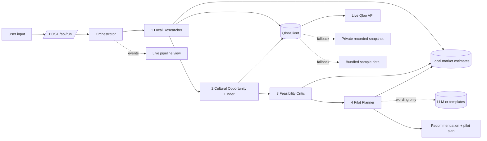

# Architecture

Culture2Commerce is one Next.js application. The browser only renders; every Qloo and LLM
call happens on the server.

## Components

| Layer | Location | Responsibility |
|---|---|---|
| UI | `src/app`, `src/components` | Input form, live agent pipeline, recommendation, pilot plan, pilot results, exports |
| API | `src/app/api/run/route.ts` | Validates input, starts a run, streams agent events (Server-Sent Events) |
| Orchestrator | `src/server/orchestrator.ts` | Runs the four agents in order, emits events, isolates failures |
| Agents | `src/server/agents/` | Four functions `(input, ctx) => output`, Zod-validated on both sides |
| Scoring | `src/server/scoring.ts` | Deterministic scores and confidence level |
| Qloo | `src/server/qloo/` | `QlooClient` interface; live, recorded and sample implementations; fallback chain |
| Local market data | `src/server/data/local-market/` | Curated illustrative estimates: stall fees, venues, permits, concept costs |
| LLM | `src/server/llm/` | Optional narrative polish; templates when disabled |
| Shared | `src/lib/` | Zod schemas and types used by server and UI |

## Data flow

## Launch modes

`launchMode` is `solo`, `partner` or `both`. The same four agents run in every mode; the mode
decides which extra work each one does and which plans the Pilot Planner builds.

| Agent | solo | partner | both |
|---|---|---|---|
| Local Researcher | neighbourhoods + locality profiles | also partner leads and the admired business | as partner |
| Cultural Opportunity Finder | cultural fit | also product tags and partner scores | as partner |
| Feasibility Critic | solo ranking, price range | also collaboration options | also the solo vs partner comparison |
| Pilot Planner | solo pilot | partner pilot with outreach | both pilots |

Partner logic lives in `src/server/partners.ts` (classification, product matching, scoring,
collaboration options, comparison) and `src/server/data/collab-profiles.ts` (per-idea venue
types and illustrative collaboration assumptions). Shared pure calculators used by both the
server and the browser: `src/lib/collab.ts`, `src/lib/pricing.ts`, `src/lib/outreach.ts`.

## Agent contracts (original solo flow)

| Agent | Input | Qloo calls | Output |
|---|---|---|---|
| **Local Researcher** | city, localities (or "suggest for me"), concepts | per locality: top places (anchors); per concept: competitor places within a radius | locality profiles: anchor venues, taste fingerprint from place tags, competitors, stall fees, venue options, permit notes |
| **Cultural Opportunity Finder** | locality profiles, concepts, user interests | per locality: tag taste analysis, brand affinity, demographics (all signalled by anchors); per concept: concept-place affinity for the anchor audience | for each concept and locality: `cultural_fit` 0 to 100, target audience, evidence items |
| **Feasibility Critic** | opportunities, budget, duration, risk preference | none | per option: cost breakdown, `feasibility`, `risk_adjustment`, verdict `accepted`, `downgraded` or `rejected` with reasons; ranked list with final scores |
| **Pilot Planner** | winning option, budget, duration | none | quantities, prices, schedule, checklist, budget, success metrics, continue / pivot / stop rule, predicted outcomes |

Every evidence item carries a `source`: `live`, `recorded`, `sample`, `estimate`, `llm` or `template`.

## Events

The orchestrator emits `queued`, `running`, `completed`, `failed` and `skipped` per agent with:
timestamp, agent, input summary, output summary, Qloo calls (endpoint and parameters, never
the key), data sources used, duration, warnings and errors.

## Failure behaviour

- A failed Qloo call falls back per call (live, recorded, sample) and records why.
- A failed agent is reported in the pipeline. Later agents continue with degraded input where
  possible; otherwise they are marked `skipped` and the run ends with a clear message.

## Scoring

`final = w1·cultural_fit + w2·feasibility + w3·risk_adjustment` (default 0.45, 0.35, 0.20).
Confidence (High, Medium, Low) is computed from data quality only: live vs fallback data,
number and strength of signals, locality-level vs city-level data, estimated vs verified costs.
